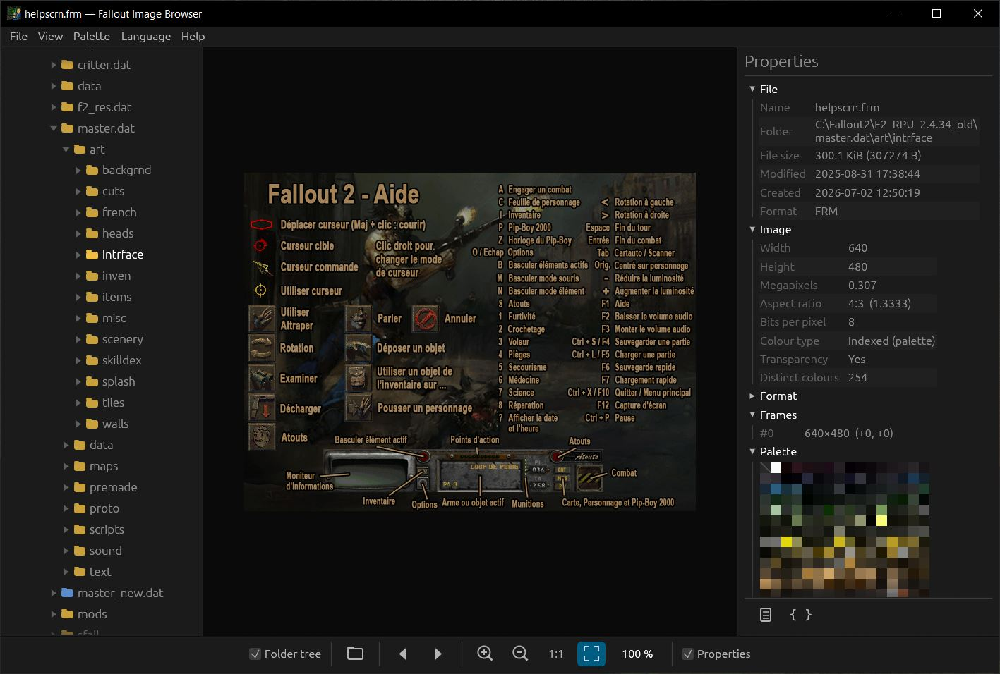
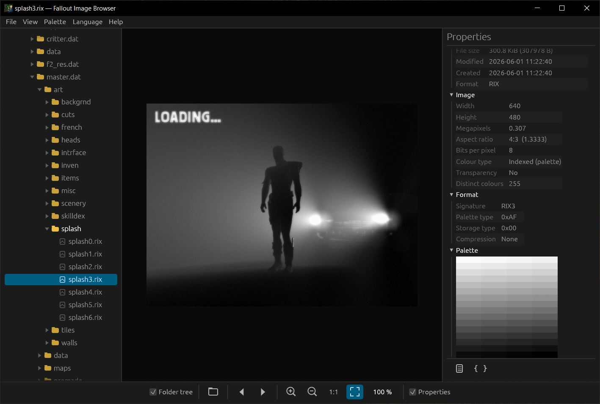
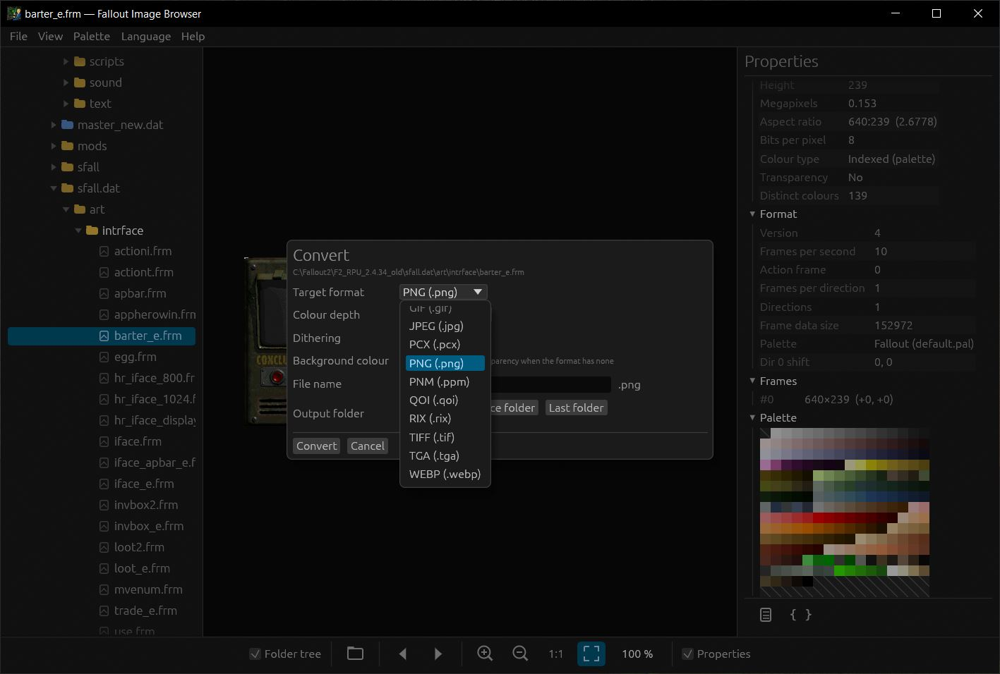

# FalloutImageBrowser

A very fast, cross-platform (Windows, Linux, macOS) image viewer and converter written in Rust with egui + wgpu.
Inspired by *Titanium FRM Browser*.


*Main window: folder tree (with `.dat` archives browsed like folders), image, and the properties panel with its palette.*

## Formats (read and write, any to any)

| Format | Depths |
|---|---|
| ART (Arcanum) | 8-bit (palette) |
| BMP | 8, 8 Fallout, 16, 24, 32-bit |
| DDS (DirectDraw Surface) | 16 (A1R5G5B5), 24, 32-bit uncompressed; compressed BC1-BC7 are also readable |
| FRM (Fallout 1/2) | 8-bit Fallout palette, or a custom `.PAL` palette (existing or created) — the only format that accepts one (animations, 6 directions) |
| GIF | 8, 8 Fallout (animated) |
| JPEG | 24-bit (YCbCr), 32-bit (CMYK) |
| PCX | 8, 8 Fallout, 24, 32-bit |
| PNG | 8 (palette, tRNS transparency), 16, 24, 32-bit; every PNG type can be read |
| PNM (PBM, PGM, PPM, PAM) | 24-bit (P6), 32-bit (P7 with alpha); reads P1 to P7, 8 and 16-bit |
| QOI | 24, 32-bit |
| KTX2 | RGBA8 lossless or BC7, Zstandard |
| RIX | 8-bit |
| ZAR (Fallout Tactics) | 8-bit, 256-colour palette with per-pixel alpha (RLE) |
| TIFF | 8, 8 Fallout, 16, 24, 32-bit |
| TGA | 8, 8 Fallout, 16, 24, 32-bit |
| WEBP | 24, 32-bit (lossless; animated files are readable) |

**Read-only** (merged image, no layers; no conversion *to* these formats):
`PSD` / `PSB` (Photoshop: RGB, grayscale, indexed, CMYK, Lab, bitmap; 1, 8, 16 and 32-bit), `XCF` (GIMP: visible layers are
stacked in Normal mode, layer masks and opacity are honoured), `KRA` (Krita: `mergedimage.png`), `ORA` (OpenRaster:
`mergedimage.png`, otherwise the layers of `stack.xml` are stacked) and `PDN` (Paint.NET, checked on a 5.x file: the format is
undocumented, so the layers' pixel blocks are located without parsing the whole stream; if the result does not match the thumbnail
in the header, the thumbnail is shown instead).
`ASE` / `ASEPRITE` (Aseprite: animation frames recomposed from the visible layers, Normal mode),
palette files `PAL` (Fallout, Microsoft RIFF, JASC), `ACT`, `GPL`, `KPL`, `HEX` (shown as a 16-column colour grid; the
*Export palette…* menu converts them from one format to another), and Fallout Tactics: `ZAR` (images), `TIL` (tiles), `SPR` (sprites: every
animation of the file, each with its own directions, selectable in the direction list). These unofficial formats were reconstructed from
community tools and checked against 277 ZAR, 123 SPR and 132 TIL real files; multi-image TIL files are untested.

Animated `WebP`, `PNG` (APNG) and `GIF` files are read with all their frames: previous / next buttons, play / pause and an "Image x / y" slider.

"8-bit" = the image's own palette (kept as is when the image is already indexed, otherwise computed),
"8-bit Fallout" = the `default.pal` palette of Fallout 2, and for every 8-bit format a custom `.PAL` palette
can also be chosen. "16-bit" is RGB 5-5-5 (native in BMP and TGA; for TIFF the colours are reduced to 5 bits and then
stored as 24-bit so that the file stays readable everywhere).

## Fallout 1 and 2 .DAT archives

`.dat` files appear in the tree as folders (blue icon): you can browse their sub-folders, and view and convert
the images they contain without extracting them. Right-click an item of an archive → *Extract…* copies it (a file, a folder
with its sub-folders, or the whole archive) to a folder you choose; files already there are kept. The command line does the same
with `extract`.
DAT2 (Fallout 2, zlib) is checked against a real `master.dat`; DAT1 (Fallout 1, block LZSS) is implemented
from the specification and checked against test archives.


*A RIX splash screen read directly from `master.dat`, with its format details and palette.*

## Interface

* Bottom bar (centred): *Folder tree* checkbox, *Current folder* button (Ctrl+L: shows the current folder path in a dialog
  where it can be edited to switch folder quickly; a folder that does not exist is ignored), previous / next image,
  zoom in / out / 100 %, fit, *Properties* checkbox.
* Left panel: folders (lazy loading) and the images of the current folder; right panel: all the information about the
  image (file, image, format, EXIF, palette, current frame). Icon buttons at the bottom of the panel: copy the image, copy
  the path | copy to…, move to…, rename… (a same-name `.PAL` follows the file; archive items can only be copied) |
  convert image…, export palette… | copy all the information as text, JSON or XML.
* Right-click on the image: Zoom 100 %, Convert image…. Conversion is a modal window (like every dialog, with a close button at the top right and large buttons) (one image at a time;
  name, format, depth, PNG compression level, output folder = last one used or the source file's folder).
* Conversion options (also on the command line): resize by percentage or to a maximum longest side (never enlarges),
  smooth (Lanczos, alpha-aware) or pixel-perfect resampling, removal of transparent margins, and a choice of dithering
  (none, Floyd–Steinberg, ordered Bayer). The window shows the resulting size and an estimate of the file size, computed by
  really encoding the image in the background.
* File → *Batch convert…* (Ctrl+B) opens an independent window (the main window stays usable): add files, folders (with or
  without sub-folders), `.DAT` archives or the current folder, pick the same settings as for one image, write next to each
  source or into one folder (optionally keeping the sub-folder layout), follow a progress bar, stop at any time and read the
  list of failures. No existing file is ever overwritten.
* Image → *Show all directions* (D): the six directions of an FRM (or the directions of an ART) side by side, animated together
  and aligned on the common origin; click a direction to select it.
* File → *Edit FRM header…*: frames per second, action frame and the X / Y offset of each direction, saved with *Save as…*;
  the images are not re-encoded.
* The zoom level is kept from one image to the next. Animations (FRM, GIF): manual playback by default,
  with an *Autoplay* option in the View menu.
* Menus: *View* (panels, fit, full screen, slideshow, autoplay, smoothing, remembered window size and position), *Image*
  (rotate and mirror the view, pixel grid, pixel information, anchor, onion skin, background), *Navigation* (current
  folder, file sort order, mouse wheel = zoom (default) or previous / next image, mouse side buttons = previous / next
  (default) or zoom), *Palette*, *Language* and *Help*.
* Drag and drop of a file (its folder becomes the current folder), a folder or a `.dat` archive.
* File → *Copy image* (Ctrl+C, also in the right-click menu) puts the displayed image (the current frame of an animation) in the clipboard.
* Folder contents: the box above the tree filters the file names of the current folder, and View → *Sort files by* sorts them by
  name (natural order: `img2` before `img10`), size, date or type, ascending or descending. Previous / next follow the same order.
* File and Palette menus → *Export palette…* (also in the right-click menu, Ctrl+P): the palette of the current image as `.PAL` (Fallout), `.PAL` (Microsoft RIFF),
  `.ACT` (Adobe), `.GPL` (GIMP), `.KPL` (Krita) or `.HEX`.
* FRM palette: the `.PAL` with the same name if present, otherwise the Fallout palette; it can be changed in the *Palette* menu.
* 16 languages (French, English, Spanish, Italian, Portuguese, Polish, Danish, Finnish, Greek, Hungarian,
  Dutch, Romanian, Swedish, Czech, Chinese, Russian). The default language is the system's
  (`FIB_LANG=xx` forces a language). Translations are in `assets/lang/*.txt`.


*The Convert window: target format, colour depth, dithering, file name and output folder.*

Shortcuts: Space / → / ↑ next, Backspace / ← / ↓ previous, Home / End, `+` `-` zoom, Enter 100 %,
`F` fit, `P` play, `D` all directions, `T` folder tree, `I` properties, `F5` reload, Ctrl+O open, Ctrl+L current folder, Ctrl+C copy image, Ctrl+E convert, Ctrl+B batch convert.

## Command line

The executable is a console application: in a terminal the shell waits for the job to finish and receives the exit
code; without arguments it opens the window (and detaches from the terminal). Help: `/?`, `-?`, `-h`, `--help` or `help`
(`--formats` lists the formats and depths, `--version`). The Help → *Command-line help* menu shows the same help.

```
fallout_image_browser [path]                       # opens the GUI (file, folder or .dat)
fallout_image_browser convert <input> -f <format> [options]
fallout_image_browser palette <input> -f pal|riff|act|gpl|kpl|hex [-o file|folder]   # the input can be an image or a palette file
fallout_image_browser extract <input> [-o folder] [--overwrite] [-q]       # input: a .DAT archive, or a folder or file inside one
```

* **File mode**: `<input>` is an image. Every readable format is accepted as input, including the read-only ones (PSD, PDN, XCF, KRA, ORA, ASE, ZAR, TIL, SPR, palette files); only the 16 writable formats (ART, BMP, DDS, FRM, GIF, JPEG, KTX2, PCX, PNG, PNM, QOI, RIX, TIFF, TGA, WEBP, ZAR) are valid for `-f`. For animations (SPR, GIF, WebP, APNG): `--frame`, `--direction`, `--sequence`.
  **Folder mode**: `<input>` is a folder (or a `.dat` archive, or a folder inside an archive); every image it contains is converted
  (`-r` for sub-folders; always the case for a whole archive, whose tree is kept under `--out`).
* Options: `-d 8|8f|8p|16|24|32` (`8p` without `--pal` creates the .PAL file), `-p file.pal`,
  `--read-pal auto|fallout|file`, `-o folder`, `-n name` (file mode), `-r`, `--dither`, `--dither-method fs|bayer`, `--scale PERCENT`, `--max-size PX`, `--resample smooth|pixel`, `--trim`, `--quality 1-100`,
  `--png-level fast|normal|best` (PNG compression: `fast` is far quicker on large photos), `--bg RRGGBB`, `--direction N`, `--frame N`, `--sequence`, `-q`, `--lang xx`. Every format / depth
  combination of the GUI is available; see `--help` for details.
* No existing file is ever overwritten (a `_converted` suffix is added). Exit code: 0 success, 1 partial failure, 2 usage error.

Examples:

```
fallout_image_browser convert critter.frm -f gif -d 8f -o out
fallout_image_browser convert D:\Fallout2\master.dat -f bmp -d 24 -o export
fallout_image_browser convert D:\art\scenery -f frm -d 8p -p mypalette.pal -r
fallout_image_browser convert gui\charcreate.zar -f png -d 32            # Fallout Tactics ZAR to PNG
fallout_image_browser convert "weapons\Mace Glove.spr" -f png --sequence # every frame of an SPR
fallout_image_browser palette default.pal -f gpl                         # Fallout palette to GIMP
```

## Explorer thumbnails (Windows)

`ShellExtension\` is a separate project that makes Windows Explorer show thumbnails for Fallout (`.FRM`, `.RIX`), Arcanum (`.ART`) and Fallout Tactics (`.ZAR`, `.TIL`, `.SPR`) files. Run
`.\ShellExtension\install.ps1` to install it for the current user (no administrator rights) and `uninstall.ps1` to remove it;
see [ShellExtension/README.md](ShellExtension/README.md).

## Robustness

Files are treated as untrusted input: sizes read from headers are checked before any memory is allocated, archive entry
names cannot point outside the output folder, decompression and animations have a memory budget, and a reader that
fails is reported as an error instead of crashing the program. `tests/robust.rs` feeds thousands of corrupted files to every reader.

## Building

```
cargo run --release -- [file-or-folder]
cargo test --release
```

`.\publish.ps1` (PowerShell 7) builds the release binaries for Windows, Linux and macOS (x64 and arm64) and writes one zip per
platform into `publish\`; run `Get-Help .\publish.ps1 -Full` for the prerequisites of the cross-compiled targets.
On Linux (Debian, Ubuntu…) and macOS, `./publish.sh` does the same; `./publish.sh --help` lists the options and the one-time setup.

GitHub Actions (`.github/workflows/build.yml`) builds and tests every push and pull request on Windows, Linux and macOS and
keeps one zip per platform as a workflow artifact. Pushing a tag such as `v0.1.0` (it must match the version in `Cargo.toml`)
also publishes the zips as a GitHub release.

The application icon is generated from `assets/icon_source.webp` by `cargo run --release --example genicon`.

## License

The code of this project is released under the [MIT License](LICENSE). The sample files in `_test_files/` come from the
original games and are not covered by it (see [_test_files/README.md](_test_files/README.md)).
